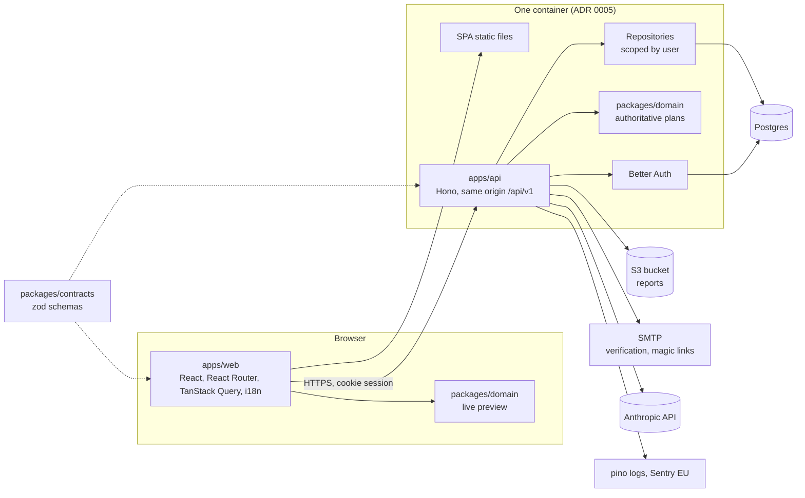

# Target architecture

Status: accepted 2026-10-16 (phase 4). This describes where we are going; `docs/audit.md` describes where we are. The why behind each part is in the ADRs linked below.

## Overview

All data and files stay in the EU. Locally, Postgres, SeaweedFS (S3) and Mailpit (SMTP) run in Docker Compose; in production, the provider is chosen in M5.

## Principles

1. **The code calculates, the AI never does.** The AI reads reports, asks and explains; requirements, doses and costs come only from `packages/domain`.
2. **One pure engine, two places.** The browser previews; the server computes every saved plan and records engine and product versions, so plans are reproducible.
3. **Contracts are defined once** in `packages/contracts` and validated at both ends at runtime.
4. **Access is scoped in one place**: repositories take the user and never return data the user does not own.
5. **Errors are values with codes**, never free text, so they can be translated, tested and handled.
6. **Portable by construction**: one container, plain Postgres, the S3 API, SMTP and environment variables.

## Request flow: saving a plan

1. The web app sends `POST /api/v1/horses/:id/plans` with the analysis ID; the session cookie identifies the user.
2. The API validates the body against the contract, loads horse and analysis through repositories (404 if not the user's), and loads the current product set version.
3. The API calls the domain engine and gets either a plan or a typed result such as `plan.infeasible`.
4. A plan is stored immutably with its inputs, engine version and product set version and returned; the web app renders it from message codes in Swedish.

## Decisions

| ADR | Decision |
|---|---|
| [0001](adr/0001-record-architecture-decisions.md) | Record architecture decisions as ADRs |
| [0002](adr/0002-own-typescript-api.md) | Own TypeScript API (Hono) instead of a backend-as-a-service |
| [0003](adr/0003-npm-workspaces-monorepo.md) | npm workspaces monorepo: apps/web, apps/api, packages/domain, packages/contracts |
| [0004](adr/0004-shared-domain-server-authoritative.md) | Shared pure domain package, server authoritative |
| [0005](adr/0005-portable-hosting.md) | Portable hosting, provider chosen in M5 |
| [0006](adr/0006-docker-compose-local-and-ci.md) | Local development and CI with Docker Compose |
| [0007](adr/0007-rest-api-shared-zod-contracts.md) | REST API with shared zod contracts |
| [0008](adr/0008-postgres-drizzle-data-model.md) | Postgres with Drizzle, and the data model |
| [0009](adr/0009-auth-better-auth.md) | Authentication with Better Auth |
| [0010](adr/0010-authorization-repository-layer.md) | Authorization through a repository layer |
| [0011](adr/0011-file-storage-s3.md) | File storage through the S3 API |
| [0012](adr/0012-frontend-routing-and-server-state.md) | Frontend: React Router and TanStack Query |
| [0013](adr/0013-error-model-problem-json.md) | Error model: problem+json with stable codes |
| [0014](adr/0014-i18n-message-codes.md) | i18n: message codes and react-i18next |
| [0015](adr/0015-config-secrets-observability.md) | Configuration, secrets and observability |
| [0016](adr/0016-swedish-domain-names-english-technical-names.md) | Swedish names for the domain, English names for the software |
| [0017](adr/0017-optimistic-concurrency-for-record-edits.md) | Optimistic concurrency for record edits |

## Refactor or rebuild, per area

| Area | Verdict | Where |
|---|---|---|
| Calculation engine | Refactor: move to `packages/domain`, validation at the boundary, typed results, message codes | M1 |
| AI functions | Refactor: move to `apps/api`, shared contracts, quotas, usage logging | M3 |
| Server hosting (Vite middleware) | Rebuild as `apps/api` | M2 |
| Auth and persistence | Rebuild with Better Auth, Postgres and repositories | M2 |
| App state and navigation | Refactor into routes with TanStack Query | M2 |
| UI components | Refactor, keep design | M1 to M2 |
| Product data | Rebuild the process: versioned table and admin view | M4 |
| Deployment | Build in M5 on the chosen provider | M5 |

Library versions named in the ADRs were current on 2026-10-16. When installing, pin the newest release that is at least two weeks old. The rule covers transitive dependencies too (owner, 2026-10-21, #61): resolve an install or upgrade with `npm install --before=<the date 14 days ago>` and `npm dedupe --before=<same date>`, so every package in `package-lock.json` meets it. Dependabot's 14 day cooldown covers direct dependencies only. For a Docker image the rule applies to the software release in its tag (PostgreSQL 18.6, not the build date); rebuilds of the same tag with operating system patches are accepted (owner, 2026-10-21, #18).
