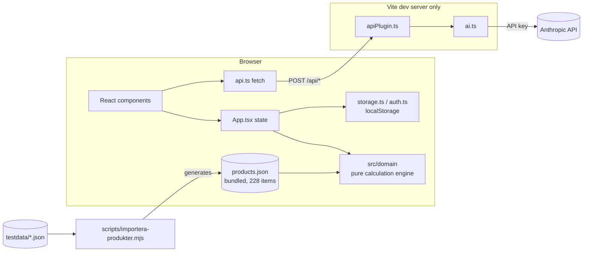

# Audit: Krubba / Fodr hackathon codebase

Date: 2026-10-15. Baseline: `main` at `9dedc8d`. Phase 1 of the hardening process, read only.

Every claim marked **verified** was checked by running something (command and result noted). Everything else comes from reading the code and is marked as such where it matters.

## 0. Urgent: secrets and committed config

**No secrets are committed, in the working tree or anywhere in history.** Verified with `git log --all -p` (all branches, including `origin/stall` and `origin/ux`) grepped for Anthropic key patterns, generic `api_key=` patterns and private key headers. No hits.

Related findings, none urgent:

| Finding | Where | Note |
|---|---|---|
| `app/.env` exists locally with `ANTHROPIC_API_KEY` | `app/.env` (untracked, ignored by `app/.gitignore:27`) | Correct. Only the key name was inspected, never the value. |
| `.env.example` was deleted by accident | Added in `292bd3d` (empty value), deleted in `53d18fc` | `README.md` still says `cp .env.example .env`, which fails. |
| No root `.gitignore` | repo root | `.DS_Store` and `testdata/.DS_Store` are tracked. |
| The 3 MB pitch PDF is tracked in the repo root | `Krubba – pitch.pdf` | Not a secret, but business material in the code repo. |

The key never reaches the browser: Vite exposes only `VITE_` variables, and `vite.config.ts:8` copies the key into the dev server process only.

## 1. Stack and structure

| Layer | Technology |
|---|---|
| Frontend | React 19, TypeScript 5.8 (strict), Vite 6, plain CSS |
| "Backend" | Vite dev server middleware (`app/server/apiPlugin.ts`) |
| AI | `@anthropic-ai/sdk` 0.133, model `claude-sonnet-5-5`, structured output via zod 4 |
| Persistence | Browser `localStorage` |
| Tests | Vitest 5, domain unit tests only |
| Lint | ESLint 9 flat config, non type aware `typescript-eslint` recommended |
| Runtime used | Node 26.10, npm 11.19 |

```
.
├── README.md, malbild.md         product goal, decisions, demo script (Swedish)
├── Krubba – pitch.pdf
├── testdata/Testdata-from-other-dev/
│   ├── granngarden-produkter.json, hooks-produkter.json   scraped store data (input to import script)
│   └── krubba-testdata-v2/       synthetic lab reports (PDF, PNG, JPG) + facit.json answer key
└── app/
    ├── server/                   ai.ts (4 Claude calls), apiPlugin.ts (routes, dev only)
    ├── scripts/                  importera-produkter.mjs, produktval.json, utvardera-utlasning.mjs
    ├── public/bilder/            marketing photos (CC0 per footer)
    └── src/
        ├── App.tsx               auth gate, workspace, ALL app state
        ├── api.ts, auth.ts, storage.ts, format.ts
        ├── components/           8 components, one per step + landing, login, calendar
        ├── data/                 products.json (generated, 228 items), exempel.ts (demo horses, analyses, journal)
        └── domain/               pure TS calculation engine + 8 test files
```

### Architecture as it actually is



The important properties:

1. **The backend exists only during `npm run dev`.** `apiPlugin.ts:39` uses `configureServer`; there is no `configurePreviewServer` and no standalone server. A production build (verified: `vite build` succeeds, 447 kB JS, 112 kB gzip) is a static site where every AI feature returns 404.
2. **All calculation happens in the browser** in `src/domain`, which is pure and framework free. This is the best designed part of the codebase.
3. **The AI never calculates.** It extracts values, interprets free text and explains results. This boundary is stated in `ai.ts:2` and the prompts, and the code respects it.
4. **There is no data layer.** State lives in React state in `App.tsx` and is mirrored to `localStorage` through `storage.ts`.

## 2. User flows today (end to end)

| # | Flow | Path through the code | AI? | Works without key? |
|---|---|---|---|---|
| F1 | Landing page, then demo login | `Startsida` → `loggaIn(DEMOKONTO.epost)` (`App.tsx:52`) → workspace seeded with Sixten and Pysen (`storage.ts:20`) | No | Yes |
| F2 | Create account or log in by email | `Login.tsx:11` → `auth.ts:38`. Password is collected and ignored. | No | Yes |
| F3 | Create and edit a horse profile | `HorseStep` → `onAndra` → `App.tsx:122` → `useEffect` saves to localStorage | No | Yes |
| F4 | Fill profile from free text, with follow-up questions | `AiHjalp` (`HorseStep.tsx:394`) → `POST /api/profil` → `tolkaProfil` → merged into profile (AI can only add sensitivities, never remove) | Yes | No, shows an error |
| F5 | Upload a lab report (PDF or photo), review and correct values | `AnalysisStep.tsx:28` → base64 → `POST /api/analys` → `lasAnalys` → `tillGrovfoderanalys` (SLU conversions) → editable table | Yes | No. Fallback: two "Exempel" buttons load hardcoded analyses. |
| F6 | Compute feed plan | `App.tsx:105` `skapaPlan` → `PlanStep`: actions, shopping list, cost, alternative, swaps, sensitivities, roughage quality, nutrient balance table, nitrogen surplus | No | Yes |
| F7 | AI explanation of the plan | `PlanStep.tsx:39` auto calls `POST /api/forklaring`, cached per horse by fingerprint in localStorage | Yes | Degrades with a message |
| F8 | Transition calendar and .ics export | `Injusteringskalender.tsx`, client side ICS generation | No | Yes |
| F9 | Journal: add entry, trend, follow up, save plan snapshot | `JournalStep` → `beraknaTrend`; optional "update profile" rewrites weight and body condition | No | Yes |
| F10 | AI journal analysis (patterns, vet flag) | `POST /api/journal` → `analyseraJournal` | Yes | No, shows an error |

Flow level gaps:

- **The analysis is not tied to a horse and is not persisted.** It lives in `Arbetsyta` state (`App.tsx:96`). A reload loses it, and switching horse reuses the previous horse's analysis for the new horse's plan.
- **No routing.** Steps are a `useState` (`App.tsx:95`); there are no URLs, no back button behaviour and no deep links.
- Unmerged work: `origin/stall` (3 commits, 30 files, about +2,500/−700 lines: stable overview, box cards, body condition scale, Swedish statistics comparison, themes) and `origin/ux` (a subset of it). These change most components and `storage.ts`. **Which branch is the baseline is an open question for phase 2.**

## 3. Mocked, stubbed, hardcoded or faked

| # | What | Where | What it would take to make it real |
|---|---|---|---|
| M1 | **Accounts.** Any email logs in, the password is never checked or stored, users live in localStorage | `auth.ts` (whole file, marked MOCK at `:1`), `Login.tsx:44-51` | A real auth provider (hosted, e.g. Supabase Auth or similar, or own sessions). `Anvandare` is a good seam, but `aktuellAnvandare()` is synchronous and every caller assumes so. |
| M2 | **Persistence.** Horses, journal and AI explanations in localStorage, per browser | `storage.ts` (whole file) | A backend with a database and an API. The seam exists, but its functions are synchronous; going async touches `App.tsx` state initialisation. |
| M3 | **The backend.** API only runs inside the Vite dev server | `server/apiPlugin.ts:39` | A real server process or serverless functions. `ai.ts` is portable as is. |
| M4 | Demo seeding: the demo account always gets Sixten, Pysen and a journal | `storage.ts:20`, `storage.ts:59`, `data/exempel.ts` | Seed data in the database, or keep as an explicit demo mode. |
| M5 | Example analyses that bypass AI extraction | `AnalysisStep.tsx:72-81`, `data/exempel.ts:45-87` | Keep as an explicit demo or onboarding feature, or remove. |
| M6 | **Product catalogue** is a one day scrape (all 228 items `insamlad: 2026-10-14`). Only 41 have complete nutrition data, 47 none. Prices are a snapshot. | `src/data/products.json` (generated), `scripts/importera-produkter.mjs` | Decide a source of truth (manual curation, supplier feeds, or scraping on a schedule), store it server side with versioning and a "last verified" date. |
| M7 | Selectable products and their doses are hand converted for a 550 kg horse | `scripts/produktval.json` (15 products; several doses are "assumed same as sibling product") | Verified dose data per product, reviewed by someone with domain knowledge. |
| M8 | Ingredients are inferred from shop descriptions with keyword matching | `importera-produkter.mjs`; weakness admitted in `malbild.md` | Hand entered ingredient lists for the selectable products at minimum. The allergy filter is unsafe until then. |
| M9 | Landing page statistics and a hardcoded "screenshot" of analysis values | `Startsida.tsx:81-95` (stats, with sources), `Startsida.tsx:113-117` (static values) | Fine for marketing; mark as content, not data. The plan preview on the same page is computed live from demo data, which is good. |
| M10 | Model ID and token limits hardcoded | `ai.ts:10`, `ai.ts:75,151,175,224` | Configuration. |
| M11 | Domain assumptions outside SLU (body condition weight factor, sugar limit, trace mineral defaults, etc.) | Marked `ANTAGANDE` throughout `src/domain` | Not mocks. They are documented assumptions and should stay visible; consider collecting them in one registry so they can be reviewed. |

## 4. Data model and where state lives

Types in `src/domain/types.ts`, `journal.ts` and `auth.ts`.

```
Anvandare { id, namn, epost }
  └─ Hastprofil[]  { id, namn, alderAr, kon, typ, viktKg, hull, ras?, ridning?, prestanda?,
                     miljo?, halsa{...sensitivities, undvik[]}, bytekanslighet?,
                     grovfoder{typ, kgPerDag}, nuvarandeFoder[{produktId|null, namn, gramPerDag}] }
  └─ Journalpost[] per horse { id, datum, viktKg?, hull?, text, plan?: PlanOgonblick }
Grovfoderanalys    { typ, labb?, provdatum?, tsProcent, askaGPerKgTs?, perKgTs: NutrientValues }   ← not stored
Produkt            { id, namn, kategori, perKg, prisKr, forpackningKg, dosGramPer100kg?, iUrval, ... }
Plan               derived, never stored (only a summary snapshot in the journal)
```

| State | Lives in | Key | Survives reload? |
|---|---|---|---|
| Session user | localStorage | `krubba.session.v1` | Yes |
| Accounts | localStorage | `krubba.konton.v1` | Yes |
| Horses | localStorage | `krubba.hastar.v2.<userId>` | Yes |
| Journal | localStorage | `krubba.journal.v1.<userId>` | Yes |
| AI explanation cache | localStorage + module Map | `fodr.forklaring.v1.<horseId>` (not scoped by user) | Yes |
| **Current analysis** | React state, `App.tsx:96` | none | **No** |
| Selected horse, step | React state | none | No |
| Products | bundled JSON | n/a | n/a |

Data model issues:

- Everything read from localStorage is cast with `as`, never validated (`storage.ts:15,55,80`, `auth.ts:18`). A schema change silently corrupts or crashes. The v1 to v2 horse key bump simply abandons old data.
- IDs come from `Date.now()` (`storage.ts:33`, `auth.ts:48`); collisions are possible within the same millisecond, and they are not globally unique once there is a server.
- Analysis has no identity and no owner. In a real product it is a first class entity: one horse has many analyses over time, and a plan references one.
- `Plan` is not persisted, only `PlanOgonblick` (names, grams, cost). There is no way to reproduce which product data or rule version produced a historical plan.
- Two names for the product: "Krubba" in docs, storage keys and plugin name; "Fodr" in the UI, `index.html`, ICS output and one storage key. The demo email is `demo@fodr.se` in code (`auth.ts:13`) but `demo@krubba.se` in `malbild.md`.
- Client and server contracts are duplicated by hand: `UtlastAnalys` (`analysis.ts:6`) and `ProfilTolkning` (`api.ts:24`) mirror the zod schemas in `ai.ts` with no shared source.

## 5. Error handling, validation and security gaps

### Correctness (verified with probe scripts, run outside the repo)

| ID | Finding | Evidence |
|---|---|---|
| C1 | **No input validation in the domain.** A 0 kg horse produces a plan with 0 MJ energy need. A `NaN` dry matter still produces a plan, with every roughage based nutrient silently computed as `NaN` (the 16 kg per day shown is simply the horse's unchanged input). No error, no warning. *(Wording corrected 2026-10-15; an earlier version implied the 16 kg was a recommendation.)* | Probe: `skapaPlan` with `viktKg: 0` and `tsProcent: NaN`. |
| C2 | UI paths that produce such values: `Siffra` turns an empty field into 0 (`HorseStep.tsx:519`); analysis edits go through `Number()` unchecked, so text becomes `NaN` (`AnalysisStep.tsx:48`) and empty dry matter becomes 0 (`AnalysisStep.tsx:96`); negative numbers are accepted everywhere. | Code reading, consequences shown by C1. |
| C3 | **Infeasible optimisation is shown as "no supplements needed".** If the roughage alone exceeds a SLU maximum, every candidate including the empty one is rejected (`optimize.ts:129`), `urval` is `null`, and `PlanStep.tsx:197` says "Inga tillskott behövs utöver grovfodret". A µg versus mg mix up in AI extraction of selenium is a realistic trigger. | Probe: Se 60 mg/kg ts gives `urval: null`, `overMax: ["se"]`. |
| C4 | Switching horse reuses the previous horse's analysis (`App.tsx:96,108`). | Code reading. |
| C5 | PSSM is treated as needing low sugar in `sensitivity.ts:25`, but the sugar warning in `plan.ts:210` checks only laminitis, EMS and PPID. | Code reading. |
| C6 | "Today" is computed in UTC (`App.tsx:22`), so between 00:00 and 02:00 Swedish time journal entries default to yesterday. The calendar uses local dates. | Code reading. |
| C7 | The AI evaluation script cannot run: its URL uses single quotes, so `${port}` is never interpolated (`scripts/utvardera-utlasning.mjs:26`). | `new URL(...)` throws `ERR_INVALID_URL`. |
| C8 | `produktId` returned by the AI is not checked against the catalogue (`HorseStep.tsx:431`); an invented ID becomes an "unknown product" note instead of a match. | Code reading. |

### Error handling

- The server maps Anthropic errors to status codes well (`apiPlugin.ts:46-55`), but everything else is a 500 with the raw `Error.message` sent to the client.
- Invalid JSON in a request body becomes a 500, not a 400.
- `parsed_output!` non null assertions (`ai.ts:80,156,229`) and several `!` in domain and UI code (`plan.ts:105`, `PlanStep.tsx:67-68,212`) turn unexpected shapes into crashes.
- No React error boundary: a render exception blanks the app.
- No request timeouts or cancellation on the client; upload has no client side size check (the server caps at 20 MB of base64).
- No logging, metrics or tracing anywhere. AI cost per request is invisible.

### Security (relevant once hosted; fine for a local demo)

- **No authentication or authorisation on `/api/*`.** Anyone who can reach the server can spend the API key.
- **No request validation** (`apiPlugin.ts:28` says so). `/api/forklaring` and `/api/journal` forward arbitrary `unknown` JSON to the model, so they work as an open, unmetered Claude proxy. `mediaType` is cast, not checked (`ai.ts:69`).
- No rate limiting, no per user quota, no body size limit beyond 20 MB.
- Free text health notes are sent to a third party API. Fine with consent; needs a privacy note once real users exist (GDPR).
- Prompt injection through uploaded documents or journal text: impact is limited because outputs are schema constrained and the AI cannot change plans, but explanation text is free form and rendered as text (React escapes it, so no XSS).
- `localStorage` holds everything in clear text per browser; the AI explanation cache is keyed by horse ID, not by user.

### Accessibility (first pass, not a full review)

- Login dialog: no focus trap, no Escape handling, no focus restore (`App.tsx:56-63`).
- Several form inputs in the analysis table have no accessible label (`AnalysisStep.tsx:135`).
- Visual state is often colour only (status chips), though text labels exist in most places.
- Good: semantic buttons, `aria-current`, `aria-pressed`, radiogroup for transition sensitivity, `lang="sv"`.

## 6. Tooling

| Tool | State | Verified |
|---|---|---|
| TypeScript | `strict`, `noUnused*`, project references for app and server. Passes. `scripts/*.mjs` are not type checked. | `npx tsc -b` exit 0 |
| ESLint | Non type aware recommended config. Tracked code passes; the 4 errors come from untracked `app/scratchverify/verify.test.ts`. | `npx eslint .` |
| Formatter | None (no Prettier, no EditorConfig). Style is consistent anyway. | `ls` |
| Unit tests | 8 files, 52 tests, all in `src/domain`, including hand calculated SLU cases. Pass in about 0.5 s. | `npx vitest run` |
| `npm test` | **Missing.** README documents it, `package.json` has no `test` script. | `package.json` |
| Component, API, e2e tests | None. | |
| AI evaluation | A script against an answer key exists (good idea), but is broken (C7) and not automated. | |
| CI | None (no `.github/`). | `ls` |
| Pre commit hooks | None. | |
| Dependency audit | 0 production vulnerabilities. | `npm audit --omit=dev` |
| Untracked scratch file | `app/scratchverify/verify.test.ts` is picked up by Vitest and ESLint. Should be deleted or ignored (your call). | `git status` |

## 7. Refactor or rebuild, per area (first opinion)

| Area | Opinion | Reasoning |
|---|---|---|
| Calculation engine (`src/domain`) | **Refactor, keep.** | Pure, tested, every value cites its source, the "unknown is not zero" rule is applied consistently. Needs input validation at its boundary, an explicit "infeasible" result instead of `null` (C3), and small cleanups (duplicated `kr`/`fmt`, cost sum logic duplicated in `PlanStep`). Rewriting this would throw away the most valuable and most verified code. |
| AI functions (`server/ai.ts`) | **Refactor, keep.** | Prompts, schemas and refusal handling are sound and were evaluated against an answer key. Needs request validation, shared contracts with the client, configuration and observability. |
| Server hosting (`apiPlugin.ts`) | **Rebuild.** | It is 60 lines bound to Vite's dev server. Any real deployment needs a real server or functions layer; little is lost by replacing it. |
| Auth and persistence (`auth.ts`, `storage.ts`) | **Rebuild.** | Mock by design. The seams are well placed, but the synchronous localStorage interface does not survive contact with a network. |
| State management (`App.tsx`) | **Refactor.** | Needs routing, analysis per horse, async data loading and error boundaries. Moderate change, not a rewrite. |
| UI components | **Refactor, decide after the branch question.** | Functional and reasonably accessible, but `origin/stall` rewrites most of them. Refactoring `main` before deciding would be wasted work. |
| Product data pipeline | **Rebuild the process, keep the importer logic.** | The import script's conversions are useful, but a one day scrape with inferred ingredients cannot be the source of truth for a product that tells owners what to feed sick horses. |
| Tooling, CI, tests | **Build from scratch.** | Almost nothing exists beyond tsc, ESLint and domain unit tests. |

## 8. Open questions for phase 2

1. Baseline: merge `origin/stall` first, or start from `main`?
2. Goal: portfolio and demo, or a product with real users? This decides whether M1 to M3 are needed at all.
3. Product data: who owns it, and how often must prices and doses be correct?
4. Can `app/scratchverify/`, `Krubba – pitch.pdf` and the tracked `.DS_Store` files be removed from the repo?
5. One name: Krubba or Fodr?
